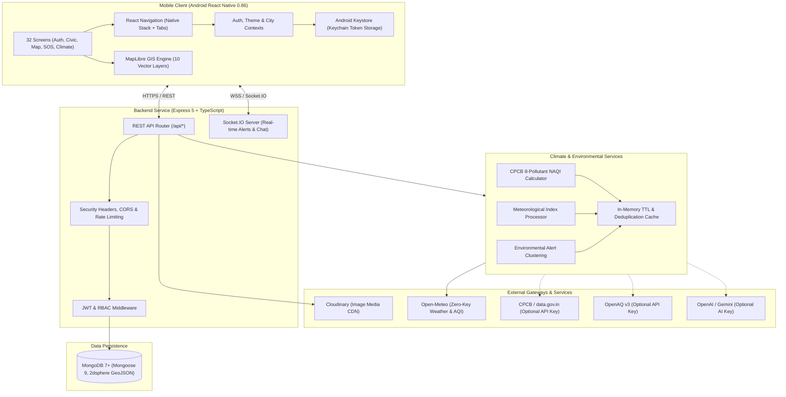

# SERPENTIS — Smart City & Climate Intelligence Platform

[](https://github.com/driveid1310-ship-it/SERPENTIS/actions/workflows/ci.yml)
[](https://nodejs.org/)
[](https://reactnative.dev/)
[](https://www.typescriptlang.org/)
[](https://www.mongodb.com/)
[](https://maplibre.org/)
[](#32-license-information)

SERPENTIS is an integrated urban operating system unifying **Civic Issue Reporting & Grievance Redressal**, **Emergency Disaster & SOS Dispatch**, **Public Services & Local Heritage Discovery**, and an **Environmental & Climate Intelligence Engine**.

Built specifically for Indian urban contexts, SERPENTIS features an official **Central Pollution Control Board (CPCB) National Air Quality Index (NAQI)** calculation engine, high-precision weather analysis, real-time alert clustering, and a 10-layer interactive **MapLibre GIS** mapping experience. The platform incorporates a multi-tier city expansion hierarchy initiated with an active pilot deployment in **Badlapur, Maharashtra** (Badlapur East and Badlapur West zones).

---

## Table of Contents

1. [Project Overview](#1-project-overview)
2. [Problem Statement](#2-problem-statement)
3. [Project Objectives](#3-project-objectives)
4. [Actual Implemented Features](#4-actual-implemented-features)
5. [Feature Implementation-Status Table](#5-feature-implementation-status-table)
6. [Technology Stack](#6-technology-stack)
7. [System Architecture](#7-system-architecture)
8. [Mobile Application Architecture](#8-mobile-application-architecture)
9. [Backend Architecture](#9-backend-architecture)
10. [Database Overview](#10-database-overview)
11. [Repository Directory Structure](#11-repository-directory-structure)
12. [Prerequisites](#12-prerequisites)
13. [Complete Windows Installation Instructions](#13-complete-windows-installation-instructions)
14. [Backend Installation and Startup](#14-backend-installation-and-startup)
15. [Mobile Installation and Startup](#15-mobile-installation-and-startup)
16. [MongoDB Setup and Configuration](#16-mongodb-setup-and-configuration)
17. [Environment Variable Configuration](#17-environment-variable-configuration)
18. [Android Emulator Setup](#18-android-emulator-setup)
19. [Physical Android Device Setup](#19-physical-android-device-setup)
20. [API Configuration](#20-api-configuration)
21. [Testing Instructions](#21-testing-instructions)
22. [TypeScript and ESLint Commands](#22-typescript-and-eslint-commands)
23. [Android Debug Build Instructions](#23-android-debug-build-instructions)
24. [Android Release Build Instructions and Signing Limitations](#24-android-release-build-instructions-and-signing-limitations)
25. [Security Considerations](#25-security-considerations)
26. [Environmental Data Accuracy and Limitations](#26-environmental-data-accuracy-and-limitations)
27. [External Service Dependencies](#27-external-service-dependencies)
28. [Current Known Issues](#28-current-known-issues)
29. [Deployment Readiness](#29-deployment-readiness)
30. [Development Roadmap](#30-development-roadmap)
31. [Contribution Instructions](#31-contribution-instructions)
32. [License Information](#32-license-information)

---

## 1. Project Overview

SERPENTIS provides citizens and municipal administrations with a synchronized digital pipeline for community problem-solving and environmental awareness:
- **Mobile Client (`mobile/`):** A modern React Native Android application engineered with React 19, TypeScript, gesture navigation, local device encryption, and vector GIS mapping.
- **Backend API (`server/`):** A Node.js and Express RESTful service reinforced with real-time Socket.IO communication, MongoDB geospatial querying, and structured security controls.
- **Scientific Intelligence Engine (`server/src/services/`):** A computational framework implementing CPCB air quality sub-indexing, scientific weather indices (Heat Index, Dew Point, Vapor Pressure Deficit), in-memory request coalescing, and environmental alert clustering.

---

## 2. Problem Statement

Rapid urbanisation across Indian tier-2 and tier-3 municipal corporations has led to severe operational challenges:
1. **Civic Fragmentation:** Citizen complaints regarding potholes, open garbage dumps, broken streetlights, and sewage overflow are often lost across informal channels or disconnected department helplines.
2. **Climate & Health Vulnerability:** Severe seasonal air pollution spikes ($PM_{2.5} / PM_{10}$), extreme heatwaves, and monsoon localized waterlogging directly impact citizen health, yet existing municipal apps fail to provide actionable, real-time environmental context.
3. **Data Misrepresentation:** Many commercial weather tools present numerical model estimates as "official" measurements without validating against regulatory standards, eroding public trust.
4. **Emergency Disconnection:** In crisis scenarios, citizens lack instant access to centralized national emergency services with automated geolocation dispatch.

---

## 3. Project Objectives

- **Unified Civic Grievance Pipeline:** Enable citizens to capture, geotag, upload photos, upvote, and track municipal complaints from submission to resolution.
- **Scientific Environmental Truthfulness:** Implement the official Indian Central Pollution Control Board (CPCB) National Air Quality Index algorithm with strict provenance labeling—explicitly separating official regulatory stations from satellite-modeled approximations.
- **Community Resilience:** Empower local neighborhood groups with real-time chat, civic leaderboards, and participatory environmental monitoring.
- **Emergency Preparedness:** Provide immediate hardware-linked emergency dialers and real-time SOS broadcast capabilities with GPS coordinates.
- **Extensible Urban Scaling:** Architect a hierarchical urban data model beginning with an initial municipal pilot in **Badlapur, Maharashtra**, designed for seamless expansion across the Mumbai Metropolitan Region and Pan-India.

---

## 4. Actual Implemented Features

### Civic Management
- **Issue Submission:** Geotagged civic complaints with multi-category classification (Pothole, Garbage, Water Leakage, Streetlight, Traffic, Pollution, Stray Animals).
- **Camera & Image Upload:** Direct hardware camera and photo library access via `react-native-image-picker`, with streaming to Cloudinary via Multer.
- **Duplicate Detection & Social Verification:** Automatic detection of nearby duplicate grievances and community upvoting to prioritize urgent issues.
- **Discussion Threads:** Nested comments on public reports with author roles.
- **Public Services Directory:** GeoJSON 2dsphere proximity search for hospitals, police stations, fire stations, municipal offices, and transit hubs.
- **Local Heritage Discovery:** Catalog of historical monuments and cultural spots with user reviews, 5-star ratings, and personal favorites.

### Environmental & Climate Intelligence
- **Official CPCB NAQI Engine:** Piecewise linear sub-index interpolation for all 8 criteria pollutants ($PM_{2.5}$, $PM_{10}$, $NO_2$, $SO_2$, $CO$, $O_3$, $NH_3$, $Pb$), strictly applying the CPCB Minimum-Three Pollutant Rule and dominant pollutant logic.
- **Zero-Key Meteorological Data:** Out-of-the-box global weather and atmospheric data powered by Open-Meteo REST APIs.
- **Atmospheric Index Calculations:** Mathematical computation of Heat Index (Rothfusz regression), Dew Point (Magnus-Tetens formula), and Vapor Pressure Deficit (VPD).
- **Automated Alert Clustering:** Automated threshold detection for Heatwaves ($\ge 40^\circ\text{C}$), Severe AQI ($> 300$), Extreme UV ($\ge 11$), and localized waterlogging risk.
- **Interactive MapLibre GIS:** 10 togglable vector layers (Urban Heat Islands, AQI Contours, Waterlogging Hotspots, Green Canopy, Noise Zones, Waste Clusters, Traffic Congestion, Heritage Buffers, Solar Potential, and Flood Plains).
- **City Intelligence Assistant:** Deterministic civic guidance fallback engine with optional conversational AI integration via OpenAI or Google Gemini.
- **Educational Carbon Footprint Calculator:** Interactive estimator calculating annual $CO_2$ emissions from household energy and weekly transit.

### Security & System Administration
- **Authentication:** JWT (JSON Web Tokens) with 7-day expiration and bcrypt password hashing (10 rounds).
- **Mobile Token Storage:** Secure hardware encryption via Android Keystore (`react-native-keychain`).
- **Cryptographic Password Reset:** HMAC-SHA256 one-time verification tokens with 15-minute expiration windows.
- **Defensive HTTP Middleware:** IP sliding-window rate limiting, strict CORS whitelisting, and defensive security headers (`nosniff`, `DENY`, `no-referrer`).
- **Role-Based Access Control:** Distinct authorization boundaries for Citizens, Moderators, and Administrators.

---

## 5. Feature Implementation-Status Table

All features within the SERPENTIS repository have been audited and classified according to their actual operational status:

| Module / Capability | Implementation Status | Verification Details |
|---|:---:|---|
| **User Registration & Login (JWT/bcrypt)** | `IMPLEMENTED AND VERIFIED` | Verified via automated security and auth test suites |
| **Mobile Keystore Token Persistence** | `IMPLEMENTED AND VERIFIED` | Verified using `react-native-keychain` Android Keystore integration |
| **HMAC OTP Password Reset via SMTP** | `IMPLEMENTED AND VERIFIED` | Cryptographic generation verified; test suite confirms token validation |
| **Civic Grievance Submission & Geotagging** | `IMPLEMENTED AND VERIFIED` | Multi-category forms and geolocation hooks operational |
| **Civic Photo Upload (Cloudinary/Multer)** | `IMPLEMENTED AND VERIFIED` | Multipart streaming handler and MIME validation verified |
| **Duplicate Issue Detection & Upvoting** | `IMPLEMENTED AND VERIFIED` | Proximity clustering and upvote counters verified in backend routes |
| **Public Service 2dsphere Geo Proximity** | `IMPLEMENTED AND VERIFIED` | MongoDB geospatial queries operational for emergency & civic places |
| **Heritage Monuments, Reviews & Favorites** | `IMPLEMENTED AND VERIFIED` | Full CRUD operational with user reviews and favorite toggles |
| **Emergency SOS Dialers (112, 100, 101, etc.)** | `IMPLEMENTED AND VERIFIED` | Core React Native `Linking.openURL('tel:...')` verified |
| **Emergency SOS Real-time Server Dispatch** | `IMPLEMENTED AND VERIFIED` | Geotagged alert creation and Socket.IO broadcast verified |
| **Community Groups & Real-time Chat** | `IMPLEMENTED AND VERIFIED` | Room joining, message history, and live Socket.IO delivery verified |
| **Gamification, Badges & Leaderboards** | `IMPLEMENTED AND VERIFIED` | Karma computation and leaderboard rankings verified |
| **CPCB 8-Pollutant NAQI Calculator** | `IMPLEMENTED AND VERIFIED` | 17/17 backend unit tests verifying official breakpoint interpolation |
| **CPCB Minimum-3 Pollutant Validation Rule** | `IMPLEMENTED AND VERIFIED` | Strict rejection of official AQI when $<3$ pollutants or no PM verified |
| **Modeled vs Official Provenance Tagging** | `IMPLEMENTED AND VERIFIED` | Strict separation (`isOfficialAqi: false` for modeled estimates) enforced |
| **Atmospheric Indices (Heat Index, Dew Point)**| `IMPLEMENTED AND VERIFIED` | Mathematical models verified against standard meteorological benchmarks |
| **Open-Meteo Weather & AQI Adapters** | `IMPLEMENTED AND VERIFIED` | Zero-key external integration verified with live response parsing |
| **In-Memory Environmental Request Cache** | `IMPLEMENTED AND VERIFIED` | Concurrent fetch deduplication and TTL expiration verified |
| **Automated Environmental Alert Clustering** | `IMPLEMENTED AND VERIFIED` | Heatwave, severe AQI, and UV alert generation verified |
| **MapLibre Native Android GIS (10 Layers)** | `IMPLEMENTED AND VERIFIED` | Vector rendering and interactive layer toggling verified |
| **Deterministic AI City Assistant Fallback** | `IMPLEMENTED AND VERIFIED` | Rule-based civic recommendations verified without external API keys |
| **Educational Carbon Footprint Calculator** | `IMPLEMENTED AND VERIFIED` | Deterministic emission estimation verified across energy/transit inputs |
| **Badlapur Pilot City Hierarchy** | `IMPLEMENTED AND VERIFIED` | Badlapur East/West zone metadata and coordinates active |
| **Android Debug APK Build** | `IMPLEMENTED AND VERIFIED` | Clean Gradle compilation to `app-debug.apk` verified |
| **Android Unsigned Release APK Build** | `IMPLEMENTED AND VERIFIED` | ProGuard/R8 optimization to `app-release-unsigned.apk` verified |
| **Offline Map Vector Tile Caching** | `PARTIALLY IMPLEMENTED` | Standard HTTP disk caching enabled; full offline region download planned |
| **Automated Pan-India Municipal Connectors**| `PARTIALLY IMPLEMENTED` | Hierarchical schema ready; municipal automated feeds planned |
| **CPCB Official data.gov.in Provider** | `BLOCKED BY MISSING CREDENTIALS`| Adapter code complete; requires user `DATAGOV_API_KEY` |
| **OpenAQ v3 Provider** | `BLOCKED BY MISSING CREDENTIALS`| Adapter code complete; requires user `OPENAQ_API_KEY` |
| **IMD Official Weather Provider** | `BLOCKED BY MISSING CREDENTIALS`| Adapter code complete; requires official IMD institutional credentials |
| **OpenAI / Gemini Conversational AI** | `BLOCKED BY MISSING CREDENTIALS`| Adapter code complete; requires user `OPENAI_API_KEY` or `GEMINI_API_KEY` |
| **Signed Production Release APK** | `BLOCKED BY MISSING CREDENTIALS`| Build scripts ready; requires production `keystore.properties` |

---

## 6. Technology Stack

### Mobile Application
- **Runtime & Framework:** React Native `0.86.0`, React `19.2.3`
- **Language:** TypeScript `5.8.3`
- **Navigation:** React Navigation `7.x` (`@react-navigation/native-stack`, `@react-navigation/bottom-tabs`)
- **GIS & Mapping:** MapLibre Native React Native `11.4.1`
- **Hardware Integration:** `@react-native-community/geolocation` `3.4.0`, `react-native-image-picker` `8.2.1`
- **Security & Storage:** `react-native-keychain` `10.0.0`, `@react-native-async-storage/async-storage` `3.1.1`
- **Real-Time Client:** `socket.io-client` `4.8.4`
- **HTTP Client:** `axios` `1.19.0`
- **Animation & UI:** `react-native-reanimated` `4.5.1`, `react-native-safe-area-context` `5.8.0`, `react-native-screens` `4.26.1`
- **Testing & Quality:** Jest `29.6.3`, ESLint `8.19.0`, React Test Renderer `19.2.3`

### Backend Service
- **Runtime & Framework:** Node.js `>=22.11.0` (ES Modules), Express `5.2.1`
- **Language:** TypeScript `5.9.3`
- **Database & ODM:** MongoDB Community / Atlas, Mongoose `9.7.4`
- **Real-Time Engine:** Socket.IO `4.8.4`
- **Authentication & Cryptography:** `jsonwebtoken` `9.0.3`, `bcrypt` `6.0.0`, Node.js native `crypto`
- **File Uploads & Media:** `multer` `2.2.0`, `cloudinary` `2.10.0`, `streamifier` `0.1.1`
- **HTTP & Utilities:** `axios` `1.21.1`, Node.js native `fetch`, `dotenv` `17.4.2`, `cors` `2.8.6`
- **Mail Service:** `nodemailer` `10.0.12`
- **Execution & Testing:** `tsx` `4.23.1`, Node.js native test runner (`node:test`, `node:assert/strict`)

---

## 7. System Architecture



---

## 8. Mobile Application Architecture

The mobile application is structured around a central Native Stack and Bottom Tab navigation hierarchy with 32 screens:

```text
mobile/src/
├── components/          # Reusable UI components (Buttons, Inputs, Cards, Headers, Modals)
├── config/              # Runtime environment resolution (env.ts)
├── context/             # Global Context Providers (AuthContext, ThemeContext, CityContext)
├── hooks/               # Custom React hooks (useLocation, useReports, usePlaces, useHeritage)
├── navigation/          # AppNavigator.tsx (Native Stack Navigator & Bottom Tabs)
├── screens/             # 32 Screen Components:
│   ├── Auth:            SplashScreen, LoginScreen, SignupScreen, ForgotPasswordScreen,
│   │                    OtpVerificationScreen, ResetPasswordScreen, PasswordResetSuccessScreen
│   ├── Civic:           HomeScreen, ReportIssueScreen, ReportDetailsScreen,
│   │                    PlacesScreen, HeritageScreen
│   ├── Emergency:       SosScreen
│   ├── Community:       CommunityScreen, CreateGroupScreen, GroupDetailsScreen,
│   │                    GroupChatScreen, LeaderboardScreen, ContributionHistoryScreen, BadgesScreen
│   ├── Environmental:   WeatherScreen, AirQualityScreen, EnvironmentalMonitoringScreen,
│   │                    EnvironmentalAlertsScreen, EnvironmentalAnalyticsScreen,
│   │                    CityAssistantScreen, CityIntelligenceScreen, CitySelectorScreen
│   └── System:          MapScreen, DashboardScreen, ThemeScreen, DesignShowcaseScreen,
│                        EditProfileScreen, PrivacySecurityScreen, HelpSupportScreen, NotificationsScreen
├── services/            # Client API services (authService, reportService, placeService, socket.ts)
├── theme/               # Design token schemas and multi-theme definitions
└── types/               # TypeScript interfaces for all business domains
```

---

## 9. Backend Architecture

The backend operates as an ES Module TypeScript application:

```text
server/src/
├── config/              # Database connection, Cloudinary configuration, Environment validation
├── controllers/         # HTTP request controllers (auth, report, sos, place, environmental, group)
├── middleware/          # Security headers, CORS origin validator, errorMiddleware, rateLimitMiddleware
├── models/              # Mongoose schemas with 2dsphere geospatial indexing and timestamps
├── routes/              # Express 5 route definitions (/api/auth, /api/reports, /api/environment, etc.)
├── scripts/             # Database verification and OpenStreetMap seeding utilities
├── services/            # Business logic and scientific computational engines:
│   ├── ai/              # CityIntelligenceAIService (Rule-based deterministic + generative adapters)
│   ├── air-quality/     # CpcbAqiCalculator, OpenMeteoAirQualityProvider, CpcbDataGovProvider
│   ├── analytics/       # ClimateAnalyticsService (Environmental trend aggregation)
│   ├── data-providers/  # Meteorological providers and shared interfaces
│   ├── environmental/   # EnvironmentalAlertService, EnvironmentalCacheService, MonitoringService
│   ├── intelligence/    # CityIntelligenceScoreService (Composite city sustainability metrics)
│   ├── location/        # IndiaLocationService (Hierarchical city/zone registry)
│   ├── smartcity/       # SmartCityCapabilitiesService (Educational carbon footprint)
│   └── weather/         # WeatherService (Calculations for Heat Index, Dew Point, VPD)
├── utils/               # JWT helper functions, badge definitions, regex sanitization
├── app.ts               # Express application initialization and middleware binding
├── server.ts            # HTTP server startup and database connection lifecycle
└── socket.ts            # Socket.IO connection handling and room-based event dispatching
```

---

## 10. Database Overview

SERPENTIS utilizes MongoDB with Mongoose schemas incorporating 2dsphere geospatial indices:

- **`User`:** Citizen credentials, role (`citizen`, `moderator`, `admin`), karma points, awarded civic badges, and preferred city.
- **`Report`:** Civic and environmental complaints containing title, category, severity, status, coordinates (`Point`), image URLs, upvotes, and duplicate references.
- **`Place` / `PublicService`:** Verified urban amenities (hospitals, police, fire, public offices) with `2dsphere` location indexing and category tagging.
- **`PlaceReview` & `PlaceFavorite`:** Community ratings (1–5 stars), written reviews, and user favorite bookmarks.
- **`SOS`:** Emergency alerts recording calling user, timestamp, coordinates, emergency type, and resolution status.
- **`Group`, `GroupMember`, `GroupMessage`:** Community organizing groups, membership rosters, and message history.
- **`WeatherObservation` & `AirQualityObservation`:** Historical and real-time environmental metrics indexed by location and timestamp.
- **`EnvironmentalAlert`:** Active and historical localized alerts for heatwaves, severe AQI, and flood hazards.
- **`MonitoringStation`:** Physical and virtual sensor stations with geographical bounding boxes.

---

## 11. Repository Directory Structure

```text
SERPENTIS/
├── .github/
│   └── workflows/
│       └── ci.yml               # Automated GitHub Actions CI workflow
├── .editorconfig                # Universal IDE formatting conventions
├── .gitattributes               # Line-ending normalisation and binary path specifications
├── .gitignore                   # Exclusions for dependencies, keystores, Android SDK, and local caches
├── CHANGELOG.md                 # Detailed milestone and release history
├── CONTRIBUTING.md              # Engineering, branching, testing, and commit conventions
├── README.md                    # Primary repository documentation
├── docs/                        # Categorized technical documentation:
│   ├── architecture/            # System, API, database, AQI, weather, and AI specifications
│   ├── deployment/              # Production deployment and Android release guides
│   ├── development/             # Installation, local configuration, and known issues
│   ├── git/                     # Git audit, repair, worktree reconciliation, and CI repair reports
│   ├── security/                # Security architecture and vulnerability audit reports
│   └── testing/                 # Test strategies, validation reports, and release hardening logs
├── documentation/               # Project report assets, screenshots, and PlantUML diagrams
├── mobile/                      # React Native 0.86 Android client application
└── server/                      # Node.js 22 + Express 5 + MongoDB backend service
```

---

## 12. Prerequisites

Before installing SERPENTIS on a Windows development workstation, verify that the following dependencies are installed and available in your environment:

| Requirement | Minimum Version | Recommended Version | Verification Command |
|---|:---:|:---:|---|
| **Operating System** | Windows 10 (64-bit) | Windows 11 (64-bit) | `winver` |
| **Node.js** | `>= 22.11.0` (LTS) | `v22.17.0` | `node -v` |
| **npm** | `>= 10.9.0` | `10.9.2` | `npm -v` |
| **Java Development Kit**| JDK 17 | JDK 21 (Temurin / Zulu) | `javac -version` |
| **Android Studio** | Hedgehog (2023.1) | Ladybug / Koala | Help $\rightarrow$ About |
| **Android SDK Platform**| API 34 | API 34 / 35 | SDK Manager |
| **Android Build-Tools** | `34.0.0` | `35.0.0` | SDK Manager |
| **MongoDB** | `>= 7.0` Community | `v7.0` / `v8.0` Local Service | `mongod --version` |
| **Git for Windows** | `>= 2.40` | `2.48+` (`autocrlf=true`) | `git --version` |

---

## 13. Complete Windows Installation Instructions

Follow these step-by-step instructions in PowerShell (Run as Administrator where appropriate) to set up your environment:

### Step 1: Configure Windows Environment Variables
Ensure your user or system environment variables contain the required paths:

```powershell
# Set JAVA_HOME (Adjust path based on your JDK installation)
[System.Environment]::SetEnvironmentVariable("JAVA_HOME", "C:\Program Files\Eclipse Adoptium\jdk-21.0.6.7-hotspot", "User")

# Set ANDROID_HOME
[System.Environment]::SetEnvironmentVariable("ANDROID_HOME", "$env:LOCALAPPDATA\Android\Sdk", "User")

# Add Platform Tools and Emulator to User PATH
$oldPath = [System.Environment]::GetEnvironmentVariable("Path", "User")
$newEntries = "$env:LOCALAPPDATA\Android\Sdk\platform-tools;$env:LOCALAPPDATA\Android\Sdk\emulator;$env:LOCALAPPDATA\Android\Sdk\cmdline-tools\latest\bin"
if ($oldPath -notlike "*platform-tools*") {
    [System.Environment]::SetEnvironmentVariable("Path", "$oldPath;$newEntries", "User")
}
```

*Restart PowerShell after updating environment variables to reload the session.*

### Step 2: Clone the Repository
```powershell
git clone https://github.com/driveid1310-ship-it/SERPENTIS.git C:\projects\SERPENTIS
cd C:\projects\SERPENTIS
```

---

## 14. Backend Installation and Startup

```powershell
cd C:\projects\SERPENTIS\server

# 1. Install dependencies strictly using the committed lockfile
npm ci

# 2. Configure environment file from template
Copy-Item .env.example .env

# 3. Compile TypeScript
npm run build

# 4. Execute test suite
npm test

# 5. Launch development server with automatic reloading
npm run dev
```

The backend will initialize on `http://127.0.0.1:5000`. You can verify operational status by opening:
`http://127.0.0.1:5000/health`

---

## 15. Mobile Installation and Startup

```powershell
cd C:\projects\SERPENTIS\mobile

# 1. Install dependencies strictly using the committed lockfile
npm ci

# 2. Configure Android SDK local properties file
$sdkPath = "$env:LOCALAPPDATA\Android\Sdk".Replace("\", "\\")
"sdk.dir=$sdkPath" | Set-Content android\local.properties -Encoding UTF8

# 3. Verify TypeScript compilation
npx tsc --noEmit

# 4. Verify ESLint formatting
npx eslint src

# 5. Run mobile unit test suite
npm test -- --watchAll=false

# 6. Start the React Native Metro bundler
npx react-native start
```

*Leave the Metro bundler window running in its own terminal.*

---

## 16. MongoDB Setup and Configuration

SERPENTIS requires an accessible MongoDB instance. You can run MongoDB locally via the Windows Service or connect to MongoDB Atlas:

### Local Windows Service
1. Download and install **MongoDB Community Server** (`>= 7.0`) from [mongodb.com](https://www.mongodb.com/try/download/community).
2. Ensure the Windows service is running:
   ```powershell
   Get-Service -Name MongoDB | Start-Service
   ```
3. Default connection URI: `mongodb://127.0.0.1:27017/serpentis`

### Optional Database Seeding
To populate initial OpenStreetMap public services and heritage points for the pilot zones:
```powershell
cd C:\projects\SERPENTIS\server
npx tsx src/scripts/seedMumbai.ts
```

---

## 17. Environment Variable Configuration

### Backend (`server/.env`)
Edit `server/.env` based on `server/.env.example`:

```ini
# Server Network Settings
PORT=5000
NODE_ENV=development
CLIENT_ORIGIN=http://localhost:8081,http://10.0.2.2:8081

# Database Configuration
MONGO_URI=mongodb://127.0.0.1:27017/serpentis

# Security & Authentication (Generate 32+ character random string in production)
JWT_SECRET=serpentis_super_secret_jwt_key_at_least_32_chars_long
JWT_EXPIRES_IN=7d
PASSWORD_RESET_SECRET=serpentis_super_secret_reset_key_at_least_32_chars_long

# Cloudinary Storage (Optional for local test runs; required for production photo uploads)
CLOUDINARY_CLOUD_NAME=your_cloud_name
CLOUDINARY_API_KEY=your_cloudinary_key
CLOUDINARY_API_SECRET=your_cloudinary_secret

# External Climate & Environmental Gateways (Optional; Open-Meteo works without keys)
DATAGOV_API_KEY=your_datagov_in_api_key
OPENAQ_API_KEY=your_openaq_api_key
OPENAI_API_KEY=your_openai_api_key
GEMINI_API_KEY=your_gemini_api_key
```

### Mobile Configuration (`mobile/src/config/env.ts`)
The mobile application dynamically determines the backend API URL:
- **Android Emulator (`__DEV__`):** Resolves automatically to `http://10.0.2.2:5000/api` (Android's loopback alias for the host computer).
- **Physical Device:** Set custom IP via Gradle project property or update `mobile/src/config/env.ts`.

---

## 18. Android Emulator Setup

1. Open **Android Studio**.
2. Open the **Virtual Device Manager** (Tools $\rightarrow$ Device Manager).
3. Select **Create Device** $\rightarrow$ **Phone** (e.g., Pixel 7 or Pixel 8).
4. Select a system image: **UpsideDownCake (API 34)** or **VanillaIceCream (API 35)** with Google APIs (x86_64).
5. Finish creation and launch the emulator.
6. Once the emulator has booted to the home screen, open a new PowerShell terminal:
   ```powershell
   cd C:\projects\SERPENTIS\mobile
   npx react-native run-android
   ```
The CLI will build the native debug APK and deploy it automatically onto the active emulator.

---

## 19. Physical Android Device Setup

1. Connect your physical Android phone to your PC via a USB data cable.
2. Enable **Developer Options** and turn on **USB Debugging** on your phone.
3. Verify your device is recognized:
   ```powershell
   adb devices
   ```
4. Set up port forwarding so the device can access your local backend and Metro bundler:
   ```powershell
   adb reverse tcp:8081 tcp:8081
   adb reverse tcp:5000 tcp:5000
   ```
5. Install and launch the application:
   ```powershell
   cd C:\projects\SERPENTIS\mobile
   npx react-native run-android
   ```

---

## 20. API Configuration

The SERPENTIS backend exposes the following primary REST endpoints:

| Domain | Route Prefix | Primary Operations |
|---|---|---|
| **System Health** | `GET /health` | Service status, database state, provider checks, and cache statistics |
| **Authentication** | `/api/auth` | `/register`, `/login`, `/profile`, `/forgot-password`, `/verify-otp`, `/reset-password` |
| **Civic Reports** | `/api/reports` | `/` (list/create), `/:id` (detail), `/:id/upvote`, `/:id/status`, `/nearby` |
| **Comments** | `/api/comments` | `/report/:reportId` (list/post) |
| **Public Services**| `/api/public-services`| `/` (list/filter), `/nearby` (geospatial query), `/:id` |
| **Places & Heritage**| `/api/places` | `/` (list), `/:id`, `/:id/reviews`, `/:id/favorite` |
| **Emergency SOS** | `/api/sos` | `/` (dispatch alert), `/active`, `/:id/status` |
| **Community Groups**| `/api/groups` | `/` (list/create), `/:id/join`, `/:id/leave`, `/:id/messages` |
| **Environmental** | `/api/environment` | `/weather`, `/air-quality`, `/alerts`, `/locations`, `/carbon-estimate` |
| **User Profile** | `/api/users` | `/profile`, `/badges`, `/karma`, `/leaderboard` |
| **Administration** | `/api/admin` | `/dashboard`, `/reports`, `/users` (restricted to admin role) |

Detailed request/response schemas are documented in [API Documentation](docs/architecture/API_DOCUMENTATION.md).

---

## 21. Testing Instructions

### Unified Workspace Pipeline Check
```powershell
cd C:\projects\SERPENTIS

# Run complete verification across backend build, backend tests, mobile types, linting, and Jest:
npm run check:all

# Run all test suites across backend and mobile:
npm test
```

### Run Backend Unit & Integration Tests
```powershell
cd C:\projects\SERPENTIS\server
npm test
```
*Executes 18 automated test suites (22 tests) covering the CPCB NAQI algorithm, meteorological calculations, environmental cache TTL, request deduplication, authentication boundaries, shared contracts, and input sanitization.*

### Run Mobile Unit Tests
```powershell
cd C:\projects\SERPENTIS\mobile
npm test -- --watchAll=false
```
*Executes Jest test suites verifying component rendering, screen navigation, and Context providers.*

---

## 22. TypeScript and ESLint Commands

### Root Workspace Commands
```powershell
cd C:\projects\SERPENTIS

# Typecheck both server and mobile simultaneously
npm run typecheck

# Lint mobile source code
npm run lint

# Build backend
npm run build
```

### Backend Direct Validation
```powershell
cd C:\projects\SERPENTIS\server
npm run build
npm run typecheck
```

### Mobile Direct Validation
```powershell
cd C:\projects\SERPENTIS\mobile
npm run typecheck
npm run lint
```

---

## 23. Android Debug Build Instructions

To build a standalone debug APK without starting the Metro runner automatically:

```powershell
cd C:\projects\SERPENTIS\mobile\android
.\gradlew.bat clean
.\gradlew.bat assembleDebug
```

The resulting debug APK is located at:
`mobile\android\app\build\outputs\apk\debug\app-debug.apk`

---

## 24. Android Release Build Instructions and Signing Limitations

### Unsigned Release APK
An optimized, obfuscated release APK can be built immediately for performance profiling:

```powershell
cd C:\projects\SERPENTIS\mobile\android
.\gradlew.bat assembleRelease -PSERPENTIS_API_URL=https://api.yourdomain.com/api
```
Output: `mobile\android\app\build\outputs\apk\release\app-release-unsigned.apk`

### Production Signed Release APK Requirements
In accordance with professional security best practices, the production Android release keystore is **intentionally not committed** to this public repository.

To generate a signed production release:
1. Generate your release signing key:
   ```powershell
   keytool -genkeypair -v -storetype PKCS12 -keystore serpentis-release-key.keystore -alias serpentis-key-alias -keyalg RSA -keysize 2048 -validity 10000
   ```
2. Copy `mobile/android/keystore.properties.example` to `mobile/android/keystore.properties`.
3. Fill in the absolute path to your keystore and passwords in `keystore.properties`.
4. Run:
   ```powershell
   cd C:\projects\SERPENTIS\mobile\android
   .\gradlew.bat assembleRelease
   ```
See [Android Release Guide](docs/deployment/ANDROID_RELEASE_GUIDE.md) for complete Play Store bundle (`bundleRelease`) deployment instructions.

---

## 25. Security Considerations

- **Zero Secret Infiltration:** The repository history is audited and contains zero production keys, database passwords, or private certificates.
- **Excluded Config Files:** `.gitignore` excludes `server/.env`, `mobile/android/local.properties`, `keystore.properties`, `*.keystore`, and build artifacts.
- **Safe Environment Templates:** Safe examples are provided in `server/.env.example` and `mobile/android/keystore.properties.example`.
- **Defensive Headers:** All API responses enforce `X-Content-Type-Options: nosniff`, `X-Frame-Options: DENY`, and `Referrer-Policy: no-referrer`.
- **Sanitized Regular Expressions:** User-submitted search queries are sanitized through an `escapeRegex` utility to prevent Regular Expression Denial of Service (ReDoS) attacks.
- Review our full [Security Architecture](docs/security/SECURITY.md) and [Phase 2 Release Security Audit](docs/security/RELEASE_SECURITY_AUDIT.md).

---

## 26. Environmental Data Accuracy and Limitations

### CPCB NAQI Compliance
- Calculations follow the official Indian Central Pollution Control Board (CPCB) methodology.
- Requires measurements for at least three pollutants, with at least one being $PM_{2.5}$ or $PM_{10}$.
- AQI is determined by the **maximum sub-index**, never by mathematical averaging.

### Provenance Safeguard
- **Official Station Data:** Tagged with `isOfficialAqi: true` and includes registered station metadata.
- **Numerical / Satellite Model Estimates:** Tagged with `isOfficialAqi: false` and explicitly labeled as `Modeled Estimate`.
- Modeled estimates must **never** be presented or relied upon as certified regulatory compliance data.

---

## 27. External Service Dependencies

| Provider / Service | Protocol | Key Required? | Purpose in SERPENTIS | Fallback Behavior |
|---|---|:---:|---|---|
| **Open-Meteo** | HTTPS / REST | **No** | Default weather, forecasts, and atmospheric data | Primary free operational provider |
| **CPCB / data.gov.in** | HTTPS / REST | Yes | Official Indian regulatory station observations | Falls back to Open-Meteo modeled data |
| **OpenAQ v3** | HTTPS / REST | Yes | Global open air quality sensor network | Falls back to Open-Meteo modeled data |
| **IMD** | HTTPS / REST | Yes | India Meteorological Department official alerts | Falls back to algorithmic alert clustering |
| **Cloudinary** | HTTPS / REST | Yes | Cloud hosting and resizing for civic report photos | Local mock preview in test environments |
| **OpenAI / Gemini** | HTTPS / REST | Yes | Generative conversational City Assistant responses | Deterministic rule-based civic guidance |
| **MapLibre Tiles** | HTTPS / Vector | No | Base vector tiles for GIS mapping | GeoJSON layer styling fallback |

---

## 28. Current Known Issues

1. **Pre-Existing Mobile Inline-Style ESLint Warnings:**
   `mobile/src/screens/` and components contain 108 non-blocking `react-native/no-inline-styles` ESLint warnings. These do not impact runtime stability or TypeScript compilation.
2. **Offline GIS Region Downloads:**
   MapLibre currently caches rendered tiles to disk using standard HTTP cache policies. Pre-downloading full offline map bounding boxes is scheduled for Milestone 16.
3. **Third-Party API Rate Limits:**
   When external API keys are omitted, environmental data relies on Open-Meteo public endpoints. An in-memory TTL cache (`EnvironmentalCacheService`) is implemented to prevent rate-limit throttling.
4. See [Known Issues Log](docs/development/KNOWN_ISSUES.md) for complete technical tracking.

---

## 29. Deployment Readiness

- **Backend CI Pipeline:** Automated GitHub Actions build (`npm run build`) and test suite (`npm test`) fully operational.
- **Mobile Client:** Android debug APK and release builds verified on Node 22 and JDK 21.
- **Containerization:** Ready for containerized deployment via Docker (see [Production Deployment Guide](docs/deployment/DEPLOYMENT.md)).

---

## 30. Development Roadmap

- [x] **Milestones 1–5 (Foundations):** Initial mobile app, Express server, JWT auth, MongoDB schemas.
- [x] **Milestones 6–10 (Civic Expansion):** GeoJSON 2dsphere places, community groups, heritage reviews, SOS alerts.
- [x] **Milestones 11–14 (Climate & Smart City):** CPCB NAQI calculation engine, 10-layer MapLibre GIS, atmospheric indices, alert clustering.
- [x] **Phase 2 Hardening:** Android RC1 readiness, security auditing, CI automation, and Git hygiene hardening.
- [ ] **Milestone 15 (Municipal Dashboard):** Web-based administrative console for municipal corporation staff.
- [ ] **Milestone 16 (Full Offline Maps):** Packaged MBTiles vector tile sets for offline emergency operations.
- [ ] **Milestone 17 (Automated Sensor Ingestion):** MQTT broker integration for municipal IoT air and water sensors.
- [ ] **Milestone 18 (Pan-India Regionalization):** Localization into Hindi, Marathi, Tamil, and Kannada.

---

## 31. Contribution Instructions

We welcome contributions! Please adhere to our project guidelines:
1. Read the [Contributing Guide](CONTRIBUTING.md) before submitting pull requests.
2. Maintain branch naming conventions: `feat/*`, `fix/*`, `docs/*`, `chore/*`.
3. Never commit sensitive files (`.env`, `*.keystore`, `local.properties`).
4. Ensure all backend tests (`npm test` in `server/`) and mobile checks (`npx tsc --noEmit` in `mobile/`) pass before requesting a review.
5. Write clear, conventional commit messages (`feat: ...`, `fix: ...`, `docs: ...`).

---

## 32. License Information

This repository contains proprietary and project-internal code (`mobile/package.json: "private": true`). Selected backend components specify an ISC license in `server/package.json`. No universal open-source license has been published at the root level.

All rights are reserved by the SERPENTIS project authors. Unauthorized commercial distribution or publication is strictly prohibited. For licensing inquiries, contact the repository maintainers.
